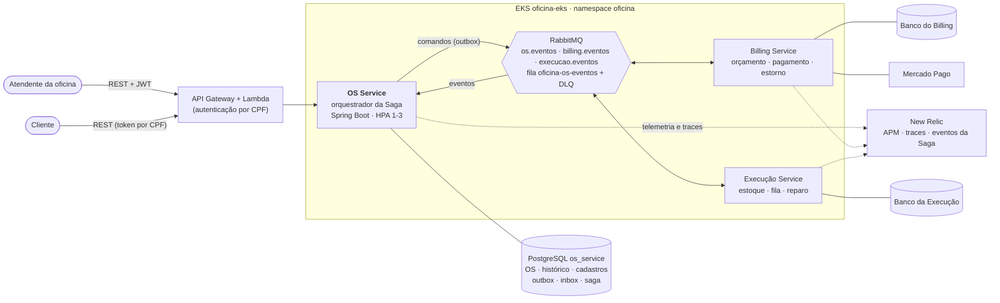
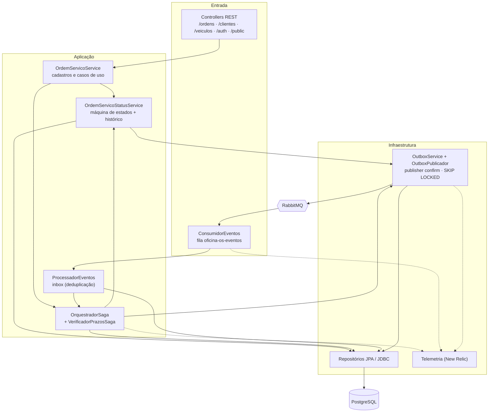
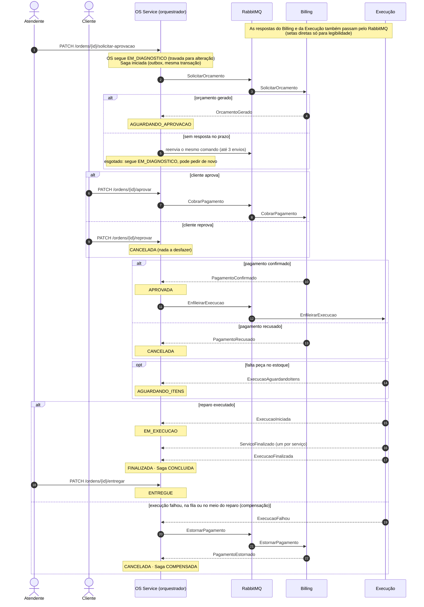
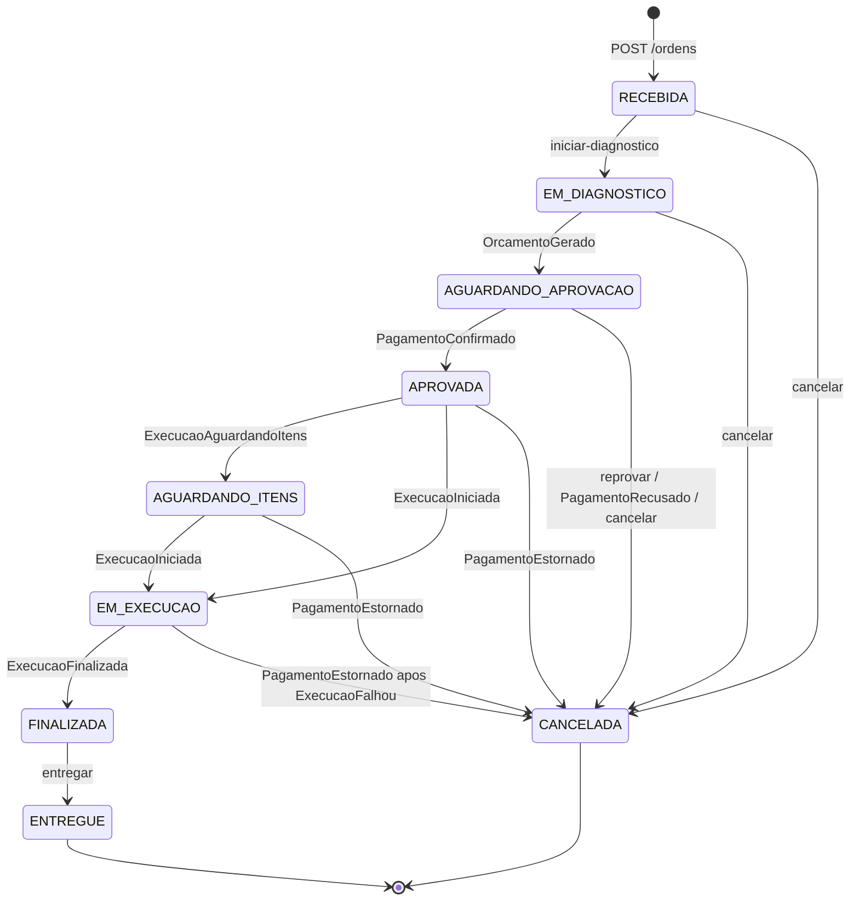
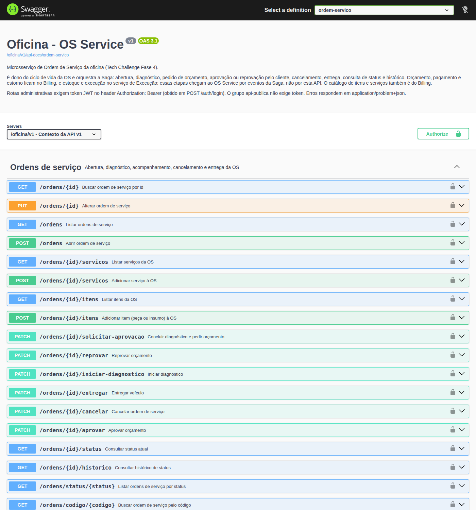
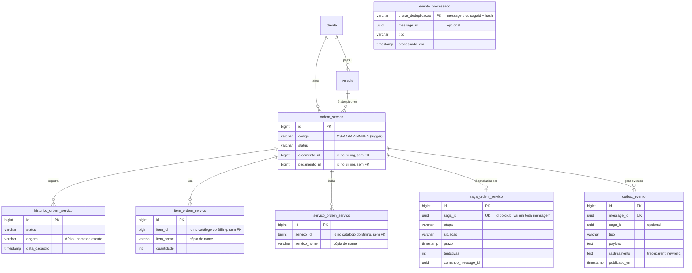
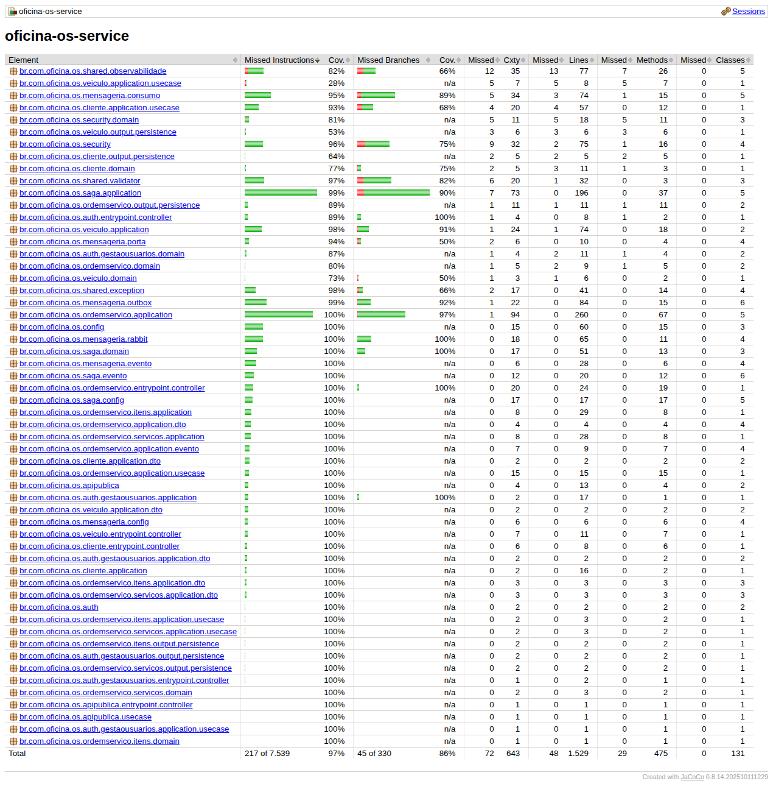
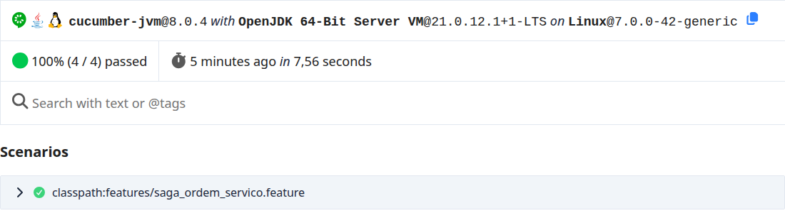

# oficina-os-service

[](https://github.com/Franciscojr08/oficina-os-service/actions/workflows/pipeline.yml)
[](https://sonarcloud.io/summary/new_code?id=Franciscojr08_oficina-os-service)
[](https://sonarcloud.io/summary/new_code?id=Franciscojr08_oficina-os-service)

Microsserviço de **Ordem de Serviço** da oficina mecânica — Tech Challenge da Fase 4 (SOAT/FIAP).

É dono do ciclo de vida da OS (abertura, diagnóstico, status, histórico, cancelamento e entrega),
dos cadastros do atendimento (cliente e veículo) e **orquestra a Saga**
que leva a OS pelo Billing (orçamento, pagamento e estorno) e pela Execução (estoque e reparo).
Conversa com os outros serviços só por mensagens (RabbitMQ), com banco PostgreSQL próprio.

## Sumário

- [Entregáveis do Tech Challenge](#entregáveis-do-tech-challenge)
- [Responsabilidades](#responsabilidades)
- [Arquitetura](#arquitetura)
- [Saga](#saga)
- [Ciclo de vida da OS](#ciclo-de-vida-da-os)
- [Mensageria](#mensageria)
- [API](#api)
- [Banco de dados](#banco-de-dados)
- [Testes e qualidade](#testes-e-qualidade)
- [Observabilidade](#observabilidade)
- [CI/CD e Kubernetes](#cicd-e-kubernetes)
- [Como rodar](#como-rodar)
- [Stack](#stack)
- [Variáveis de ambiente](#variáveis-de-ambiente)
- [Vídeo](#vídeo)
- [Pendências e decisões em aberto](#pendências-e-decisões-em-aberto)

## Entregáveis do Tech Challenge

Itens do PDF da Fase 4 para cada repositório e onde estão neste:

| Exigência | Onde |
| --- | --- |
| Código-fonte | `src/main/java` (Java 21, Spring Boot) |
| Dockerfile e manifestos Kubernetes | [`Dockerfile`](Dockerfile) e [`k8s/`](k8s) — ver [CI/CD e Kubernetes](#cicd-e-kubernetes) |
| Pipeline de CI/CD (build, testes, qualidade, deploy em Kubernetes) | [`.github/workflows/pipeline.yml`](.github/workflows/pipeline.yml) |
| Branch main protegida, PR obrigatório com checagens | [`scripts/proteger-main.sh`](scripts/proteger-main.sh) (checks Qualidade, Imagem e Manifestos) |
| Evidências de cobertura de testes | [Evidências](#evidências): 95,5% das linhas, print do JaCoCo e relatório no CI |
| Testes unitários e cobertura mínima de 80% | 442 testes; o build falha abaixo de 80% (JaCoCo) |
| Fluxo completo testado com BDD | [`src/test/resources/features`](src/test/resources/features) — ver [BDD](#bdd) |
| Qualidade via SonarQube ou similar no CI | SonarCloud com quality gate no job Qualidade, além de SpotBugs, Checkstyle e Trivy |
| Saga Pattern com rollback e compensação, escolha justificada | [Saga](#saga) e [ADR 0001](docs/adr/0001-saga-orquestrada.md) |
| Mensageria assíncrona; nenhum acesso ao banco de outro serviço | [Mensageria](#mensageria), [`docs/mensageria.md`](docs/mensageria.md) |
| Banco próprio (relacional) | PostgreSQL `os_service`, migrations Flyway — ver [Banco de dados](#banco-de-dados) |
| Documentação da arquitetura do serviço | [Arquitetura](#arquitetura), diagramas em [`docs/arquitetura`](docs/arquitetura) e ADRs em [`docs/adr`](docs/adr) |
| Swagger ou collection Postman atualizada | Swagger UI em `/oficina/v1/swagger-ui.html` e [`docs/postman`](docs/postman) (todos os endpoints, garantido por teste) |
| Monitoramento e observabilidade (ferramentas da Fase 3) | New Relic — ver [Observabilidade](#observabilidade) |
| Roteiro da parte do OS Service no vídeo | [`docs/video/roteiro-os-service.md`](docs/video/roteiro-os-service.md) |

## Responsabilidades

| Fica no OS Service | Saiu para outro serviço |
| --- | --- |
| Cliente e veículo (`/clientes`, `/veiculos`) | Catálogo de serviços e itens, com preço → Billing |
| Abertura, diagnóstico, consulta e entrega da OS (`/ordens`) | Estoque e movimentação de estoque → Execução |
| Itens e serviços da OS: só o id do catálogo, o nome (cópia) e a quantidade | Orçamento, pagamento e estorno → Billing |
| Aprovação e reprovação do orçamento pelo cliente (`/ordens/{id}/aprovar`, `/reprovar`) | Iniciar execução, iniciar e finalizar serviço → Execução |
| Histórico de status com a origem de cada mudança | Relatório de tempo médio (por OS e por serviço) → Execução |
| Acompanhamento público por código (`/public/ordens`) | |
| Login de funcionários e validação do JWT (`/auth`, `/usuarios`) | |

A divisão e o porquê estão no [ADR 0004](docs/adr/0004-fronteiras-do-servico.md).

## Arquitetura

### Visão geral



- O **API Gateway** encaminha as requisições do atendente (token de operador) e do cliente (token
  emitido pela Lambda de autenticação por CPF) para o OS Service.
- O **OS Service** grava a OS e, na mesma transação, os comandos para os outros serviços (outbox); um
  publicador os envia ao RabbitMQ. As respostas chegam pela fila `oficina-os-eventos`.
- **Billing** e **Execução** não se conhecem: só recebem comandos do OS Service e respondem com
  eventos. Cada serviço tem o próprio banco; referências entre eles são ids lógicos.
- Os três serviços enviam traces e eventos ao **New Relic**; uma OS aparece num trace único.

### Componentes internos



O código segue as camadas do monólito da Fase 3 (`entrypoint`, `application`, `domain`, `output`
por módulo), mais os módulos `mensageria` (outbox, consumo, topologia), `saga` (orquestrador, prazos)
e `shared/observabilidade` (telemetria).

### Decisões de arquitetura

| ADR | Decisão |
| --- | --- |
| [0001](docs/adr/0001-saga-orquestrada.md) | Saga orquestrada, com o OS Service como orquestrador |
| [0002](docs/adr/0002-rabbitmq-outbox-e-consumo-idempotente.md) | RabbitMQ com Transactional Outbox e consumo idempotente |
| [0003](docs/adr/0003-pagamento-antes-da-execucao.md) | Pagamento antes da execução (compensação real com estorno) |
| [0004](docs/adr/0004-fronteiras-do-servico.md) | Fronteiras do OS Service (cliente e veículo ficam; catálogo, estoque, pagamento e execução saem) |
| [0005](docs/adr/0005-rastreamento-atraves-do-outbox.md) | Trace distribuído atravessando o outbox |

Os diagramas também estão em PNG em [`docs/arquitetura/png`](docs/arquitetura/png), para o PDF do
portal.

## Saga

**Estratégia: Saga orquestrada, com o OS Service como orquestrador** (`OrquestradorSaga`).

**Por quê** (detalhes no [ADR 0001](docs/adr/0001-saga-orquestrada.md)):

- O OS Service já é o dono do ciclo de vida da OS; o status da OS é, na prática, o estado da Saga.
- O fluxo e as compensações ficam num lugar só: fácil de entender, testar e rastrear.
- Billing e Execução não precisam conhecer um ao outro: a Execução nunca sabe que existe estorno.
- Prazos e compensações em andamento precisam de estado, guardado em `saga_ordem_servico` (etapa,
  situação, prazo, tentativas e o comando que espera resposta).

O pagamento acontece antes da execução, o que dá à Saga uma compensação financeira real
([ADR 0003](docs/adr/0003-pagamento-antes-da-execucao.md)).



| Saída | O que o OS Service faz | OS | Saga |
| --- | --- | --- | --- |
| Cliente reprova (`PATCH /ordens/{id}/reprovar`) | Cancela; nada foi cobrado | `CANCELADA` | `CANCELADA` |
| `PagamentoRecusado` | Cancela; nada foi cobrado | `CANCELADA` | `CANCELADA` |
| `ExecucaoFalhou` (na fila, esperando peça ou no meio do reparo) | Publica `EstornarPagamento` e espera `PagamentoEstornado` para cancelar | `APROVADA`, `AGUARDANDO_ITENS` ou `EM_EXECUCAO` → `CANCELADA` | `COMPENSANDO` → `COMPENSADA` |
| Cancelamento de OS paga (API) | Publica `CancelarExecucao` e `EstornarPagamento`; responde 202 | `APROVADA` ou `AGUARDANDO_ITENS` → `CANCELADA` | `COMPENSANDO` → `COMPENSADA` |
| Prazo esgotado | Reenvia o mesmo comando (mesmo `messageId`) até 3 envios; depois compensa | orçamento: segue `EM_DIAGNOSTICO` e pode pedir de novo; estorno: sem mudança | `COMPENSADA` ou `FALHA_COMPENSACAO` |

- Só as etapas que esperam resposta automática têm prazo: orçamento (5 min) e estorno (10 min).
  Aprovação do cliente, pagamento (um Pix pode demorar) e execução não expiram.
- Estorno sem confirmação depois das tentativas deixa a Saga em `FALHA_COMPENSACAO` e um log de
  erro (`saga_falha_compensacao`): o pagamento precisa ser verificado manualmente.
- Evento fora de ordem ou que não combina com a etapa da Saga vai para a DLQ sem mexer na OS.
- A Saga é travada no banco a cada evento, cancelamento e verificação de prazo, o que serializa o
  que acontece com a mesma OS.
- O histórico da OS registra a origem de cada mudança: `API`, o nome do evento ou
  `PrazoOrcamentoEsgotado`.

## Ciclo de vida da OS



- São 9 status, os do contrato da Fase 4. A espera por uma resposta não é status, é a etapa da
  Saga: com o orçamento sendo gerado a OS segue em `EM_DIAGNOSTICO` e fica travada para alteração; com
  a cobrança em andamento segue em `AGUARDANDO_APROVACAO` e não pode ser cancelada (o pagamento pode
  se confirmar a qualquer momento).
- A OS pode ir para `CANCELADA` de qualquer status antes de `EM_EXECUCAO`. Uma OS que já estava
  em `EM_EXECUCAO` só é cancelada pela compensação, quando a Execução falha e o estorno se confirma.
- A API dispara `RECEBIDA → EM_DIAGNOSTICO`, `FINALIZADA → ENTREGUE`, o cancelamento e a decisão do
  cliente sobre o orçamento (`aprovar` pede a cobrança ao Billing; `reprovar` cancela). As demais
  transições vêm dos eventos da Saga.
- `ServicoFinalizado` (um por serviço) é informativo: a OS só muda de status em `ExecucaoFinalizada`.
- Cancelamento de OS paga responde 202: a OS continua em `APROVADA` ou `AGUARDANDO_ITENS` até o
  Billing confirmar o estorno e só então vai para `CANCELADA`.

Toda mudança passa pelo `OrdemServicoStatusService`, que valida o status de origem, carimba a data da
etapa, grava o histórico com a origem (`API` ou o nome do evento) e grava o evento
`OrdemServicoStatusAlterado` no outbox.

## Mensageria

O contrato completo (exchanges, envelope, tipos e garantias) está em
[docs/mensageria.md](docs/mensageria.md). Em resumo:

- O OS Service publica na topic exchange `os.eventos` e consome da fila `oficina-os-eventos`, ligada
  às exchanges `billing.eventos` e `execucao.eventos`. Mensagem que não pode ser processada vai para
  `oficina-os-eventos-dlq`.
- **Outbox:** o evento é gravado em `outbox_evento` na mesma transação da OS; o publicador agendado
  envia com confirmação do broker e, com o broker fora, guarda o evento e reenvia na ordem. Várias
  réplicas podem publicar ao mesmo tempo (`FOR UPDATE SKIP LOCKED`).
- **Consumo idempotente:** o `messageId` vai para `evento_processado` na mesma transação do efeito;
  mensagem repetida é ignorada.
- **Falhas:** mensagem inválida vai direto para a DLQ; falha transitória tem 3 tentativas antes.
- **Rastreio:** o `correlationId` da requisição HTTP segue no envelope e no header
  `x-correlation-id`, e volta para o MDC (logs) quando a mensagem é consumida.

Com o ambiente no ar, o painel do RabbitMQ mostra exchanges, filas e mensagens.

## API

Base: `http://localhost:8080/oficina/v1`. Contrato completo no Swagger UI; erros respondem em
`application/problem+json` (400 validação, 403 acesso negado, 404 inexistente, 405 método, 422 regra
de negócio).

| Endpoint | O que faz |
| --- | --- |
| `POST /ordens` | Abre a OS em `RECEBIDA` |
| `PUT /ordens/{id}` | Altera a OS (só em `RECEBIDA` e `EM_DIAGNOSTICO`) |
| `GET /ordens`, `/ordens/{id}`, `/ordens/cliente/{id}`, `/ordens/codigo/{codigo}`, `/ordens/status/{status}` | Consultas |
| `GET /ordens/{id}/status` | Status atual |
| `GET /ordens/{id}/historico` | Histórico de status com data e origem (`API` ou evento da Saga) |
| `PATCH /ordens/{id}/iniciar-diagnostico` | `RECEBIDA → EM_DIAGNOSTICO` |
| `POST`/`GET /ordens/{id}/itens`, `/ordens/{id}/servicos` | Itens e serviços da OS (inclusão só em `EM_DIAGNOSTICO`). O request leva `itemId`/`servicoId` do catálogo do Billing e o `nome`, que o OS guarda como cópia; o OS não consulta nem valida o catálogo (o Billing valida ao orçar) |
| `PATCH /ordens/{id}/solicitar-aprovacao` | Pede o orçamento ao Billing e inicia a Saga; a OS segue `EM_DIAGNOSTICO` até o `OrcamentoGerado` (exige item e serviço) |
| `PATCH /ordens/{id}/aprovar` | Cliente aprova o orçamento (`AGUARDANDO_APROVACAO`): publica `CobrarPagamento`; vira `APROVADA` com o `PagamentoConfirmado` |
| `PATCH /ordens/{id}/reprovar` | Cliente reprova o orçamento: `AGUARDANDO_APROVACAO → CANCELADA`, nada cobrado |
| `PATCH /ordens/{id}/cancelar` | Cancela antes da execução (200); OS paga passa pelo estorno (202) |
| `PATCH /ordens/{id}/entregar` | `FINALIZADA → ENTREGUE` |
| `GET /public/ordens/codigo/{codigo}` | Acompanhamento sem autenticação |
| `/clientes`, `/veiculos`, `/usuarios`, `/auth/login` | Cadastros e login |

Catálogo de itens e serviços (`/itens`, `/servicos`), relatórios de tempo médio (`/relatorios`),
execução e estoque saíram da API (respondem 404): são do Billing e da Execução.

### Quem acessa o quê

| Token | Acesso |
| --- | --- |
| Operador `ADMIN` | Toda a API |
| Operador `ATENDENTE` | Toda a API, exceto `/usuarios` |
| Cliente (Lambda de autenticação por CPF) | Só as próprias OS: `GET /ordens/{id}`, `/ordens/{id}/status`, `/ordens/{id}/historico`, `/ordens/cliente/{seu id}` e `PATCH /ordens/{id}/cancelar`. OS de outro cliente responde 404 |
| Sem token | `/auth/login`, `/public/**`, Swagger e health |

### Postman

A collection `docs/postman/oficina-os-service.postman_collection.json` exercita todos os endpoints
em sequência (57 requests com asserções), do login ao cancelamento, incluindo os erros esperados.
Os dados são gerados a cada execução, então ela roda várias vezes no mesmo banco. O teste
`ColecaoPostmanCobreEndpointsTest` falha se algum endpoint ficar sem request.

Com o ambiente no ar e a carga inicial aplicada:

```bash
docker run --rm --network host -v "$PWD/docs/postman:/etc/newman:ro" postman/newman:6-alpine \
  run oficina-os-service.postman_collection.json -e oficina-os-service-local.postman_environment.json
```

No Postman, importe a collection e o environment `OS Service - Local` e rode pelo Runner.



## Banco de dados



As migrations ficam em `src/main/resources/db/migration` e são aplicadas pelo Flyway na subida.

| Migration | Conteúdo |
| --- | --- |
| V1–V4 | `cliente`, `veiculo`, `servico`, `item` (tabelas de catálogo removidas na V15) |
| V5 | `ordem_servico`, com geração do código `OS-AAAA-NNNNNN` por trigger, datas das etapas da Saga e `orcamento_id` / `pagamento_id` (ids do Billing, sem FK) |
| V6 | `historico_ordem_servico` (com `origem`), `item_ordem_servico`, `servico_ordem_servico` (sem status de execução) |
| V7 | `usuario` |
| V8 | Índice sobre o CPF normalizado, usado pela Lambda de autenticação. A expressão precisa ser idêntica à da consulta da Lambda |
| V9 | `outbox_evento` (Transactional Outbox) e `evento_processado` (deduplicação do consumo) |
| V10 | `saga_ordem_servico`: etapa, situação, prazo e tentativas da Saga de cada OS |
| V11 | `outbox_evento.rastreamento` (contexto do trace guardado com o evento) e `saga_ordem_servico.iniciada_em` (duração da Saga) |
| V12 | `sagaId` na Saga e no outbox; chave de deduplicação do consumo (`evento_processado`) que aceita mensagem sem `messageId` |
| V13 | Status da OS do contrato (9): traduz `AGUARDANDO_ORCAMENTO`, `AGUARDANDO_PAGAMENTO` e `AGUARDANDO_EXECUCAO` na OS e no histórico |
| V14 | A OS deixa de guardar valor: remove `valor_total_*` de `ordem_servico` e `valor_unitario` de `item_ordem_servico` e `servico_ordem_servico` (sem volta; o Billing é dono dos preços) |
| V15 | Sem catálogo local: `item_ordem_servico` e `servico_ordem_servico` guardam o id lógico (sem FK) e uma cópia do nome (backfill pelas tabelas antigas); `item` e `servico` são removidas (sem volta; exporte o catálogo para o Billing antes) |

## Testes e qualidade

```bash
./mvnw verify          # testes, relatório de cobertura e check de 80% de linhas
scripts/quality.sh     # verificação completa e cálculo do IQC
```

O `./mvnw verify` roda os testes unitários e os de integração, que sobem PostgreSQL e RabbitMQ com
Testcontainers (o Docker precisa estar ativo). O relatório de cobertura fica em
`target/site/jacoco/index.html`, e o build falha se a cobertura de linhas ficar abaixo de 80%.

### BDD

Os cenários ficam em [`src/test/resources/features`](src/test/resources/features), em português:

| Cenário | O que mostra |
| --- | --- |
| Caminho feliz, do orçamento à entrega do veículo | O cliente aprova pela API, e a OS percorre os 9 status do contrato (inclusive `APROVADA` e `AGUARDANDO_ITENS`) pelos eventos do Billing e da Execução; o histórico registra a origem de cada mudança |
| Cliente reprova o orçamento e nada é cobrado | A OS é cancelada sem pedido de cobrança, de reparo nem de estorno |
| Execução falha na fila e o pagamento é estornado | O OS Service pede o estorno e só cancela a OS quando o Billing confirma |
| Execução falha no meio do reparo e o pagamento é estornado | Mesmo caminho, com a OS já em `EM_EXECUCAO`: o estorno a leva a `CANCELADA` |

Os passos (`br.com.oficina.os.bdd`) usam a API do OS Service como o atendente e simulam o Billing
e a Execução pelo RabbitMQ real (Testcontainers). Os cenários rodam no `./mvnw verify`, pela suíte
`CenariosBddTest`; passo sem implementação derruba o build. Para rodar só eles:

```bash
./mvnw test -Dtest=CenariosBddTest -Djacoco.skip=true
```

O relatório fica em `target/cucumber/relatorio.html` (e `relatorio.xml`, no formato JUnit, para o CI).

O `scripts/quality.sh` aplica as [regras de execução e qualidade](docs/REGRAS_EXECUCAO_E_QUALIDADE.md):
testes, Spotless, Checkstyle, SpotBugs, varredura do Trivy e cálculo do IQC (mínimo 90, sem
bloqueadores). O resultado fica em `target/quality/iqc.md`. Para corrigir a formatação, use
`./mvnw spotless:apply`.

### Evidências

Resultado do `scripts/quality.sh` (o mesmo do job Qualidade do CI), em 2026-11-06:

| Indicador | Resultado |
| --- | --- |
| Testes | 473 aprovados, 0 falhas (unitários, integração com Testcontainers e BDD) |
| Cobertura de linhas | **96,9%** (1.483 de 1.531 linhas; mínimo exigido 80%) |
| Cobertura de branches | 86% |
| Cenários BDD | 4 de 4 aprovados |
| SpotBugs + FindSecBugs, Checkstyle, Spotless | 0 achados |
| Trivy (dependências, imagem, segredos, Dockerfile e manifestos) | 0 HIGH/CRITICAL |
| IQC ([regras](docs/REGRAS_EXECUCAO_E_QUALIDADE.md)) | 100 / 100, sem bloqueadores |

Cobertura por área (linhas):

| Área | Linhas | Área | Linhas |
| --- | ---: | --- | ---: |
| `saga` | 100% | `apipublica` | 100% |
| `config` | 100% | `ordemservico` | 99,3% |
| `mensageria` | 98,9% | `auth` | 95,6% |
| `security` | 92,5% | `cliente` | 90,9% |
| `shared` | 90,7% | `veiculo` | 90,7% |

**JaCoCo** (`target/site/jacoco/index.html`; no CI, artefato `relatorios-qualidade`):



**Cucumber** (`target/cucumber/relatorio.html`):



**SonarCloud:** a análise roda no job Qualidade, com quality gate obrigatório; os badges no topo
mostram o estado atual. O print do painel entra em `docs/evidencias/sonarcloud.png` depois da primeira
análise (ver [Pendências](#pendências-e-decisões-em-aberto)).

## Observabilidade

Guia completo em [docs/observabilidade/README.md](docs/observabilidade/README.md). Em resumo:

- **Tracing distribuído:** o contexto do trace é guardado com o evento no outbox e vai nos headers da
  mensagem (`traceparent`, `tracestate`, `newrelic`). O consumidor abre a transação
  `Mensagem/<tipo>` no mesmo trace, então uma OS aparece num trace único do atendente até a Execução.
- **Eventos de negócio:** `SagaOrdemServicoTransicao` (etapa, situação, gatilho, motivo e duração
  ao encerrar), `SagaComandoReenviado`, `MensagemRejeitada`, `OutboxFalhaPublicacao` e os eventos de
  status da OS.
- **Métricas:** eventos pendentes no outbox, mensagens processadas e duplicadas.
- **Dashboard** importável em [docs/observabilidade/dashboard-saga.json](docs/observabilidade/dashboard-saga.json)
  (Saga, Mensageria, Tracing distribuído, Ordem de serviço), com alertas sugeridos no guia.
- **Agent:** injetado no EKS pelo operator do New Relic já instalado no cluster
  (`k8s/overlays/eks/newrelic-instrumentation.yaml`); fora dele a telemetria vira no-op.

## CI/CD e Kubernetes

### Pipeline (`.github/workflows/pipeline.yml`)

| Job | Quando | O que faz |
| --- | --- | --- |
| Qualidade | PR e merge | `scripts/quality.sh` (testes, BDD, cobertura ≥ 80%, Spotless, Checkstyle, SpotBugs, Trivy, IQC ≥ 90) e quality gate do SonarCloud. IQC no resumo da execução e relatórios como artefato |
| Imagem | PR e merge | Build da imagem e scan do Trivy (HIGH/CRITICAL com correção disponível barra) |
| Manifestos | PR e merge | `kubeconform` nos overlays `eks` e `local` |
| Deploy EKS | Só no merge para a `main` | Publica a imagem no ECR com a tag do commit, cria os Secrets, aplica `k8s/overlays/eks`, espera o rollout, confere a imagem dos pods e faz smoke test no Load Balancer |

Os três primeiros são os checks obrigatórios da `main` (`scripts/proteger-main.sh`).

### Manifestos (`k8s/`)

```text
k8s/
├── base/                    Deployment, Service, ConfigMap e HPA do OS Service
├── componentes/rabbitmq/    RabbitMQ no cluster (StatefulSet + Service)
└── overlays/
    ├── eks/                 namespace oficina, Service LoadBalancer, ENVIRONMENT=hml
    └── local/               kind: + PostgreSQL e segredos de desenvolvimento
```

- **Deploy sem queda:** rolling update com `maxUnavailable: 0` e `preStop` de 10 s. Medido no kind:
  650 requisições durante a troca de versão, nenhuma falha (sem o `preStop` eram 3 falhas).
- **Probes:** `startupProbe` segura a subida da JVM; liveness e readiness usam o Actuator.
- **Segurança:** usuário não root (UID 10001), raiz somente leitura (só `/tmp` gravável), sem
  privilégios e sem token da service account montado.
- **HPA:** 1 a 3 réplicas por CPU (70%). Várias réplicas são seguras: o outbox usa `SKIP LOCKED` e
  o consumo é idempotente.
- **Secrets** nunca são versionados: o pipeline cria `os-service-secret` e `rabbitmq-secret` a
  partir dos GitHub Secrets.
- **RabbitMQ** usa `emptyDir`, porque o cluster do Learner Lab não tem volume persistente (driver EBS
  CSI). Se o pod do broker for recriado, mensagens na fila se perdem; eventos ainda não publicados
  continuam no outbox.

Deploy só pelo script (`scripts/deploy-k8s.sh <overlay> <namespace> <imagem>`): um `kubectl apply -k`
direto troca a imagem pela tag `local` da base.

### Validação local (kind)

```bash
scripts/k8s-local.sh            # cria o cluster, constrói a imagem e publica com o script do pipeline
kubectl -n oficina-os-local port-forward service/os-service 18080:80
kubectl -n oficina-os-local exec deploy/postgres -- \
  psql -U postgres -d os_service -c "$(cat scripts/carga-inicial.sql)"   # admin@oficina.com / admin
scripts/k8s-local.sh --remover  # apaga o cluster
```

### Configuração externa (uma vez)

O pipeline depende de configurações fora do repositório:

1. **SonarCloud:** importar o repositório em sonarcloud.io (organização `franciscojr08`), desligar a
   *Automatic Analysis* (a análise vem do CI) e gerar um token.
2. **GitHub → Settings → Secrets and variables → Actions:**

   | Secret | Conteúdo |
   | --- | --- |
   | `SONAR_TOKEN` | Token do SonarCloud |
   | `AWS_ACCESS_KEY_ID`, `AWS_SECRET_ACCESS_KEY`, `AWS_SESSION_TOKEN` | Credenciais do Learner Lab (expiram a cada sessão) |
   | `OS_DATASOURCE_URL` | `jdbc:postgresql://<endpoint-do-rds>:5432/os_service` |
   | `OS_DATASOURCE_USERNAME`, `OS_DATASOURCE_PASSWORD` | Usuário do banco do OS Service |
   | `SECURITY_JWT_SECRET` | O mesmo segredo da Lambda de autenticação e da API principal |
   | `RABBITMQ_USERNAME`, `RABBITMQ_PASSWORD` | Usuário do RabbitMQ do cluster |

   Variáveis opcionais (com o default entre parênteses): `AWS_REGION` (`us-east-1`),
   `EKS_CLUSTER_NAME` (`oficina-eks`), `SONAR_ORGANIZATION` (`franciscojr08`), `SONAR_PROJECT_KEY`
   (`Franciscojr08_oficina-os-service`).
3. **Banco:** o database `os_service` precisa existir no RDS (o Flyway cria as tabelas na subida).
4. **Proteção da main:** `scripts/proteger-main.sh` (requer `gh` logado com permissão de admin).

## Como rodar

Pré-requisitos: Java 21 e Docker.

### Tudo em container

```bash
cp .env.example .env          # opcional: todos os valores têm default
docker compose up -d --build  # sobe PostgreSQL, RabbitMQ e a aplicação; o Flyway aplica as migrations
docker compose exec -T postgres psql -U postgres -d os_service < scripts/carga-inicial.sql  # opcional
```

O script de carga cria clientes, veículos, serviços, itens e o usuário `admin@oficina.com` (senha
`admin`).

| Recurso | URL |
| --- | --- |
| Health | http://localhost:8080/oficina/v1/actuator/health |
| Swagger UI | http://localhost:8080/oficina/v1/swagger-ui.html |
| RabbitMQ (painel) | http://localhost:15672 (guest / guest) |

### Aplicação local, dependências em container

```bash
docker compose up -d postgres rabbitmq
./mvnw spring-boot:run
```

### Autenticação

```bash
curl -X POST http://localhost:8080/oficina/v1/auth/login \
  -H 'Content-Type: application/json' \
  -d '{"email":"admin@oficina.com","senha":"admin"}'
```

Use o token devolvido no cabeçalho `Authorization: Bearer <token>`. O token de cliente emitido pela
Lambda de autenticação por CPF também é aceito, desde que assinado com o mesmo `SECURITY_JWT_SECRET`,
mas só dá acesso às OS do próprio cliente (ver [Quem acessa o quê](#quem-acessa-o-quê)).

## Stack

| Área | Tecnologia |
| --- | --- |
| Linguagem / framework | Java 21, Spring Boot 4.1.2 |
| Banco | PostgreSQL 15 (banco próprio `os_service`), Flyway |
| Mensageria | RabbitMQ (Spring AMQP), Transactional Outbox, consumo idempotente, DLQ |
| Segurança | Spring Security + JWT (mesmo token da Lambda de autenticação por CPF) |
| Testes | JUnit, Mockito, Testcontainers (PostgreSQL e RabbitMQ), Cucumber (BDD), JaCoCo |
| Qualidade | Spotless, Checkstyle, SpotBugs + FindSecBugs, Trivy |
| Observabilidade | New Relic (tracing distribuído, eventos da Saga, dashboard), Actuator (probes), logs JSON (ECS) com correlation id |
| Documentação da API | springdoc-openapi (Swagger UI) |

## Variáveis de ambiente

| Variável | Default | Descrição |
| --- | --- | --- |
| `SPRING_DATASOURCE_URL` | `jdbc:postgresql://localhost:5432/os_service` | URL JDBC do banco do serviço |
| `SPRING_DATASOURCE_USERNAME` | `postgres` | Usuário do banco |
| `SPRING_DATASOURCE_PASSWORD` | `postgres` | Senha do banco |
| `SPRING_DATASOURCE_POOL_SIZE` | `5` | Tamanho do pool Hikari |
| `SPRING_RABBITMQ_HOST` | `localhost` | Host do RabbitMQ |
| `SPRING_RABBITMQ_PORT` | `5672` | Porta do RabbitMQ |
| `SPRING_RABBITMQ_USERNAME` | `guest` | Usuário do RabbitMQ |
| `SPRING_RABBITMQ_PASSWORD` | `guest` | Senha do RabbitMQ |
| `OFICINA_OUTBOX_AGENDAMENTO_HABILITADO` | `true` | Liga o publicador agendado do outbox |
| `OFICINA_OUTBOX_INTERVALO_MS` | `1000` | Intervalo entre rodadas do publicador, em milissegundos |
| `OFICINA_OUTBOX_LOTE` | `50` | Máximo de eventos publicados por rodada |
| `OFICINA_MENSAGERIA_NOVAS_TENTATIVAS` | `2` | Novas tentativas no consumo antes de mandar para a DLQ (falha transitória) |
| `OFICINA_RETENCAO_OUTBOX_DIAS` | `7` | Dias que um evento já publicado fica no outbox |
| `OFICINA_RETENCAO_EVENTOS_PROCESSADOS_DIAS` | `30` | Janela de deduplicação: dias que o id de uma mensagem consumida é lembrado |
| `OFICINA_SAGA_PRAZO_ORCAMENTO` | `5m` | Prazo para o Billing responder ao pedido de orçamento |
| `OFICINA_SAGA_PRAZO_ESTORNO` | `10m` | Prazo para o Billing confirmar o estorno |
| `OFICINA_SAGA_MAX_TENTATIVAS` | `3` | Envios do comando (original e reenvios) antes de compensar |
| `OFICINA_SAGA_VERIFICACAO_HABILITADA` | `true` | Liga o verificador agendado de prazos |
| `OFICINA_SAGA_VERIFICACAO_INTERVALO_MS` | `30000` | Intervalo entre verificações de prazo, em milissegundos |
| `SECURITY_JWT_SECRET` | segredo de desenvolvimento | Segredo HS256 do JWT, o mesmo da Lambda de autenticação (mínimo de 32 caracteres) |
| `SECURITY_JWT_EXPIRATION` | `7200000` | Validade do token de funcionário, em milissegundos |
| `SPRING_PROFILES_ACTIVE` | — | `docker` liga os logs estruturados em JSON |
| `ENVIRONMENT` | `local` | Ambiente informado nos logs JSON |

## Vídeo

- **Link:** a definir pelo grupo (YouTube ou Vimeo, até 15 minutos).
- **Roteiro da parte do OS Service:** [`docs/video/roteiro-os-service.md`](docs/video/roteiro-os-service.md)
  — arquitetura, fluxo completo de uma OS, falha com estorno, deploy pelo pipeline e trace no New
  Relic, em cerca de 5 minutos.

## Pendências e decisões em aberto

| Item | Situação |
| --- | --- |
| SonarCloud, GitHub Secrets e proteção da main | Configuração externa, passo a passo em [Configuração externa](#configuração-externa-uma-vez). Depois da primeira análise, salvar o print em `docs/evidencias/sonarcloud.png` |
| Primeiro deploy no EKS | Depende dos secrets e do database `os_service` no RDS. Se o Learner Lab bloquear o ECR, trocar o registro da imagem no pipeline |
| Trace pelos três serviços | Billing e Execução precisam publicar a resposta dentro da transação que consumiu o comando ([guia](docs/observabilidade/README.md#o-que-os-outros-serviços-precisam-fazer)) |
| Lambda de autenticação lê a tabela `cliente` | Conflita com "nenhum serviço acessa o banco de outro"; decisão do grupo ([ADR 0004](docs/adr/0004-fronteiras-do-servico.md)) |
| RabbitMQ sem volume persistente no EKS | O cluster não tem o driver EBS CSI; mensagens na fila se perdem se o pod do broker for recriado (eventos não publicados ficam no outbox) |

As regras de trabalho e o índice de qualidade do repositório estão em
[`docs/REGRAS_EXECUCAO_E_QUALIDADE.md`](docs/REGRAS_EXECUCAO_E_QUALIDADE.md).
